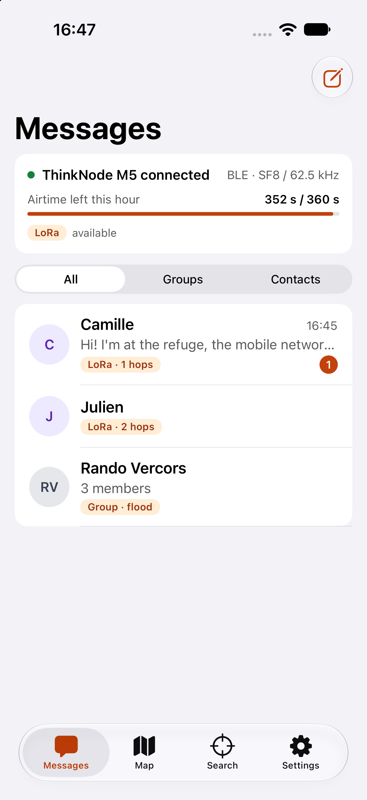
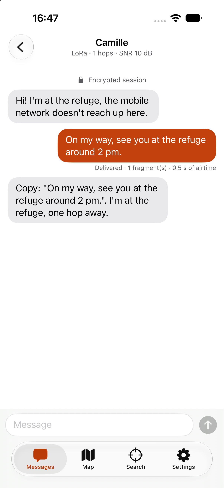

# lichen

Off-grid encrypted messaging.
<br clear="left">

Encrypted messaging on top of the **stock MeshCore** network: long fragmented messages, ChaCha20-Poly1305 with forward secrecy, private groups, media, location sharing and a search mode. No firmware is modified: the app talks to the MeshCore companion (Bluetooth or USB) and carries its frames in `RAW_CUSTOM` and `GRP_DATA` packets.

- Normative spec: [`docs/spec/protocol.md`](docs/spec/protocol.md); original design: [`docs/spec/design.md`](docs/spec/design.md) (French original: [`design.fr.md`](docs/spec/design.fr.md)).
- Decisions: [`docs/decisions/`](docs/decisions/). Mockups: [`docs/maquettes/`](docs/maquettes/). Logo and palette: [`docs/brand/`](docs/brand/).
- Shared Rust core; iOS app (SwiftUI) first, then Android (Compose).

| Crate | Role |
|---|---|
| `lc-meshcore` | `no_std` app side of the MeshCore companion protocol, USB framing, on-air header, ECDH, LoRa airtime |
| `lc-proto` | `no_std` lichen frame, crypto, handshake, ACK-on-Error fragmentation |
| `lc-core` | sessions, contacts, paths, airtime budget, storage; fake MeshCore network for tests |
| `lc-cli` | `lichen` command-line client over USB |
| `lc-ffi` | UniFFI bindings for Swift and Kotlin, and a demo network for the apps |
| `lc-media` | voice (Codec2) and image thumbnails (AVIF) for LoRa |

## iOS app

```sh
scripts/build-ios-core.sh                 # Rust core → apps/ios/LichenCore.xcframework + Swift bindings
cd apps/ios && xcodegen generate          # Lichen.xcodeproj from project.yml
open Lichen.xcodeproj                     # Run on a simulator or an iPhone
```

Without a MeshCore node (or in the simulator, which has no Bluetooth), Settings → **Try the demo network** runs the app's real core against a simulated network with two other users and a group, in real time.

| Messages | Chat |
|---|---|
|  |  |

```sh
scripts/check.sh                                               # all checks
cargo run --release -p lc-cli -- sim --repeaters 3 --loss 10   # a transfer on the fake network
cargo run --release -p lc-cli -- info /dev/cu.usbmodem2141101  # a real companion over USB
```
