# lichen

Off-grid encrypted messaging.
<br clear="left">

Encrypted messaging on top of the **stock MeshCore** network: long fragmented messages, ChaCha20-Poly1305 with forward secrecy, private groups, media, location sharing and a search mode, and, from the same app, what MeshCore already offers: plain chats with people on the stock MeshCore apps, channels, room servers, repeaters and the radio's settings. No firmware is modified: the app talks to the MeshCore companion (Bluetooth, USB or TCP) and carries its frames in `RAW_CUSTOM` and `GRP_DATA` packets.

- Getting started (a radio, its firmware, pairing, a first message): [`docs/getting-started.md`](docs/getting-started.md) ([français](docs/getting-started.fr.md)). Before each release: [`docs/field-checklist.md`](docs/field-checklist.md).
- Normative spec: [`docs/spec/protocol.md`](docs/spec/protocol.md); original design: [`docs/spec/design.md`](docs/spec/design.md) (French original: [`design.fr.md`](docs/spec/design.fr.md)).
- Decisions: [`docs/decisions/`](docs/decisions/). Mockups: [`docs/maquettes/`](docs/maquettes/). Logo and palette: [`docs/brand/`](docs/brand/).
- Shared Rust core; an iOS app (SwiftUI) and an Android app (Jetpack Compose), in English and French.
- Security: [`SECURITY.md`](SECURITY.md). No third party has audited lichen.

## What works today

On both apps; the spec and the decisions say exactly how each works.

- **Chats:** long texts, and an outbox that takes them while the radio is away and survives a restart (§6.1); replies, reactions, edits and deletes for everyone, forwarding, disappearing messages (§6.2–6.5); stickers and GIFs; tappable links, and places that open on the map; drafts; reply or mark as read from a notification; search; pin, mute, archive and block (ADR-0034). New conversation puts its actions (a new group, a channel to join, a contact to add) and the channels first and the people last, filtered by lichen or MeshCore; typing a `#tag` there joins that channel. Someone you never met who writes first arrives as a request, to accept, block or delete (ADR-0046).
- **Groups** of up to 32: invitation by QR code, posts signed and flooded twice, lost posts asked back from their author or the admin, voice notes of up to 6 s, the admin's role handed over; newcomers cannot read what came before (§10, ADR-0038 to ADR-0040).
- **Media and files:** voice (Codec2), photos (AVIF thumbnails) and files up to 8 KB over LoRa, their airtime shown first; full photos and files up to 64 MiB over the Internet (iroh or Tor) when both phones have it (§13, §14).
- **Location and SOS:** position sharing, exact or on a grid of 100 m to 10 km; map areas kept for offline use; an SOS to your groups and to the people you share with; Locate, which finds someone in SOS without GPS from their radio's signal (§11, §12).
- **MeshCore:** plain chats with people on the stock apps, their mentions and replies read and written as the stock app does (§15.9); channels (Public, hashtags, QR codes); contacts added from the stock app's links and codes, and your radio's own code to share; room servers, repeaters (status, neighbours, console), the nodes heard, each with its signal rated against your preset or its hops through repeaters, the route that reaches each one drawn leg by leg and on the map, traces; adverts sent nearby or across the mesh; the radio's settings, each change saying on its row whether the radio saved it, kept its old value, refused it or did not answer, and the phone's position for the adverts when the radio's GPS has no fix; several saved radios; and the history of the official MeshCore app (§15, §16).
- **On the phone:** an identity kept in the Keychain or Keystore and backed up as 24 words; the history in an encrypted database (SQLCipher); an encrypted backup file those words open; an app lock; a problem report with nothing personal in it (ADR-0036, ADR-0037, ADR-0045). Fragments and airtime stay out of the way unless Settings › Show radio details is on.

## Status

Experimental: version 0.10 (every merge is a numbered release, 0.10.1, 0.10.2…; Settings › About shows yours), protocol version 2 (older builds cannot talk to it).

- **Not audited by a third party.** An internal review of 2026-11-15 and an independent second read of its fixes on 2026-11-17: every finding, its reproduction, its fix and what stays open are in [`docs/security-review-2026-11-15.md`](docs/security-review-2026-11-15.md). Read [`SECURITY.md`](SECURITY.md) before relying on lichen.
- **On real radios**, texts, voice notes, photos, a file and the outbox have been tested between two radios on one desk: an iPhone over Bluetooth, the command line over USB, and the Android app in the emulator through `lichen bridge`. Since then the iPhone app has run over Bluetooth with a ThinkNode M5 on a real mesh: its contacts, channels and settings. There has been no long-range field test yet, and the Android app has not run on a phone.
- Everything else, room servers, repeaters and traces included, runs on the fake network (`lc-core`'s tests, a simulated companion) and on the apps' demo network, where every user-facing flow is tested on both apps: [Tests](#tests).

## Install

- **Android:** [`lichen.apk`](https://github.com/tduh42/lichen/releases/latest/download/lichen.apk), from the [latest release](https://github.com/tduh42/lichen/releases/latest). Every change merged into `main` that passes the checks is a [release](https://github.com/tduh42/lichen/releases) of its own, numbered (0.10.1, 0.10.2…) and listing what changed; watch the repository's releases to hear of new ones. Each is signed with lichen's release key (it installs over the one before) and lists the APK's SHA-256 and the certificate's fingerprint. The app shows its version in Settings › About. Android 12 or later, 64-bit ARM.
- **iPhone:** there is no App Store build. A free Apple ID is enough to install it from a Mac: [On your own iPhone](#on-your-own-iphone).
- **Without a radio:** Settings › Demo network (iOS: Try the demo network) runs the app's real core against a simulated network, in real time: two other lichen users and a group, two people on the stock MeshCore app, two repeaters and a room server.

## How lichen works

The same tour with live diagrams: [`docs/how-lichen-works.html`](docs/how-lichen-works.html), to open in a browser. Every figure comes from the spec, the decisions and the measurement log ([`docs/measurements.md`](docs/measurements.md)); fake-network figures are labelled as such.

[A message's journey](#a-messages-journey) · [A frame](#a-frame-byte-by-byte) · [Long messages](#long-messages-one-round-at-a-time) · [A messenger first](#a-messenger-first) · [Identity](#who-you-are-and-how-strangers-meet) · [Groups](#groups) · [Location](#location) · [Finding someone](#finding-someone) · [Media and files](#media-and-files) · [Internet bridge](#the-internet-bridge) · [MeshCore](#meshcore-around-you) · [Airtime](#360-seconds-an-hour)

### A message's journey

<picture>
  <source media="(prefers-color-scheme: dark)" srcset="docs/readme/journey-dark.svg">
  
</picture>

Everything lichen adds lives in a Rust core on the phone. The companion radio and the repeaters keep their stock MeshCore firmware: the core speaks the companion's documented protocol over Bluetooth, USB or TCP. Direct messages travel as `RAW_CUSTOM` packets along a known path, which repeaters forward without reading; groups travel as `GRP_DATA` floods. The core is IO-free (time and randomness are injected); the iOS and Android apps and the `lichen` command line only run it.

| 176 B | 184 B | 160 |
|---|---|---|
| largest companion frame | largest on-air payload (path up to 64 B) | hashes in each node's duplicate filter |

### A frame, byte by byte

<picture>
  <source media="(prefers-color-scheme: dark)" srcset="docs/readme/frame-dark.svg">
  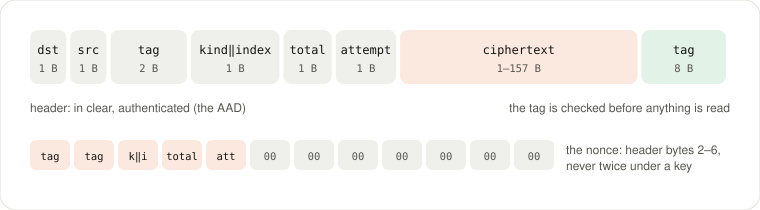
</picture>

Every frame starts with a 7-byte header in clear, authenticated with the body; five of its bytes become the nonce. The body is ChaCha20-Poly1305 as RFC 8439 defines it, with its full 16-byte tag (ADR-0028). `tag` counts datagrams per session and direction and `attempt` numbers the round, so a nonce never repeats under a key. Sessions are never stored: after a restart, a new handshake.

| 146 B | 64 | 9,344 B |
|---|---|---|
| data per fragment | fragments in a datagram | largest datagram |

### Long messages, one round at a time

<picture>
  <source media="(prefers-color-scheme: dark)" srcset="docs/readme/fragments-dark.svg">
  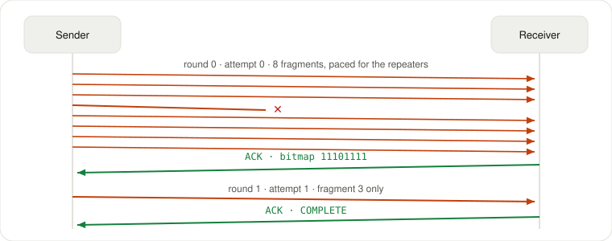
</picture>

A datagram is cut into fragments sent in rounds (ACK-on-Error, after RFC 8724). The receiver answers a round with a 64-bit bitmap of what it holds, and the next round carries only what is missing. Hand-offs are paced for half-duplex repeaters, and the next frame waits for the answer it expects, so it does not collide with it at a shared repeater.

| 1000 / 1000 | 74.2 | 49 / 50 |
|---|---|---|
| 10 KB datagrams delivered at 10 % loss on the link | frames on average at 10 % loss (65 with none) | 10 KB over 3 repeaters at 10 % loss per link (fake network) |

### A messenger first

<picture>
  <source media="(prefers-color-scheme: dark)" srcset="docs/readme/messenger-dark.svg">
  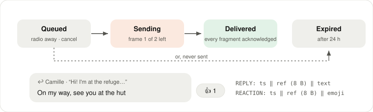
</picture>

Chatting off-grid comes first. A message is accepted while the radio is away, survives a restart, says why it waits, and can be cancelled until its first frame leaves; the phone keeps the intent (chat, text, expiry), never a session, key, nonce or ciphertext. Replies and reactions name their message by an 8-byte reference both phones compute. Stickers are animated emoji every phone already has, and a GIF travels as its GIPHY id only: one packet each, no API key. Group changes appear as lines in the conversation ("Léa joined", "Camille removed Bob").

Your own messages can be edited or taken back for everyone for 24 hours, and anything can be forwarded. A conversation can make its messages disappear after 5 minutes to a week: the setting travels to the other phones, and each removes a message that long after storing it. Links are tappable but nothing is fetched to preview them; coordinates in a text open the map. A notification can be answered, through the outbox, once the phone is unlocked; with the app lock on, it only says "New message". Blocking someone is local: the core drops what they send, and they are not told.

| 24 h | 8 B | 2.2 s |
|---|---|---|
| a waiting message's life; edits and deletes | reference a reply, reaction, edit or delete carries | a 👍 one hop away, every frame counted (fake network) |

### Who you are, and how strangers meet

<picture>
  <source media="(prefers-color-scheme: dark)" srcset="docs/readme/introduction-dark.svg">
  
</picture>

Your identity is a key made on your phone from a seed in the Keychain or Keystore, backed up as 24 words; the radio's key only routes. Strangers meet with a three-frame introduction on the Noise XX pattern; later sessions use HELLO / HELLO_ACK with fresh ephemeral keys, bound to everything both sides said, so even a stolen seed does not let someone answer as your contacts (ADR-0029). Comparing the 60-digit safety number, one tap from every conversation's header, or scanning a `lichen:1:` card in person marks a contact verified; a contact that suddenly shows another key is not adopted until you accept it.

Someone who writes first, from a radio you hold no identity for, is a request: what they send waits apart, nothing else of theirs is used, and you accept (they become the contact, unverified), block that identity (not the radio, which may be someone else's) or delete it (ADR-0046). The history sits in a database encrypted with SQLCipher under a key the Keychain or Keystore holds (ADR-0036); an encrypted backup file, opened by the 24 words, restores it on a new phone (ADR-0037).

| 1.9 s | 1.2 s | 12 × 5 | 24 |
|---|---|---|---|
| a first meeting, one hop | a later session | safety number digits | recovery words |

### Groups

<picture>
  <source media="(prefers-color-scheme: dark)" srcset="docs/readme/groups-dark.svg">
  
</picture>

A post is encrypted once with the sender's key, signed with the sender's identity, and flooded twice. Keys travel over pairwise sessions; when people join, the admin relays every key, so strangers never need a session with each other. People next to you join by scanning a QR code that holds the admin's public card and a 10-minute token, never a key. Nobody else can put you in a group: an invitation from someone you have not verified waits for your answer.

When someone joins, every key steps forward one-way, at no airtime cost: newcomers cannot read what came before. When someone leaves or is removed, everyone draws a new key, and the admin keeps sending the change for a day to whoever has not received it. The admin can hand the group over in a signed link, and does so before leaving unless it closes the group (ADR-0038). Members keep the last hour of posts, across restarts: one who misses a post asks the author or the admin for it, and gets the original signed envelope back, shown as "arrived late"; 6 to 9 minutes after an author's last post, a small signed digest reveals it if it was lost (ADR-0040). A voice note of up to 6 seconds goes to a group too, in at most 5 flooded fragments, its cost shown first (ADR-0035).

| 100 % | 78.9 % | 130 s | 1–32 |
|---|---|---|---|
| posts delivered at 10 % loss per link with recovery (96.0 % without) | a burst's last posts delivered at 20 % loss, with the digest (55.6 % without) | two people join by QR: every key everywhere (median of 10; 489 s before the relay) | members; a group may start with the admin alone |

### Location

<picture>
  <source media="(prefers-color-scheme: dark)" srcset="docs/readme/location-dark.svg">
  
</picture>

A position is 14 bytes. Both sides extrapolate the last one along its heading and speed; a new one goes out only when reality drifts more than 50 m from the guess. A coarse position is the centre of a fixed grid cell, never random noise; standing still, only a heartbeat goes out. Nothing puts a position in a MeshCore advert or telemetry unless you turn it on, after a warning (ADR-0032).

| 4 | 33 B | ≈ 1.19 m |
|---|---|---|
| positions for a 20-minute walk with a turn | one direct position on air (365 ms) | latitude step |

### Finding someone

<picture>
  <source media="(prefers-color-scheme: dark)" srcset="docs/readme/search-dark.svg">
  
</picture>

An SOS without GPS still sends a short beacon every 2 minutes. Searchers, in the Map's Locate mode, measure each one, ping when allowed and share what they measure; a particle filter keeps a heat map and a 95 % ellipse. Secondary to messaging: it runs for an SOS, or with the group's consent.

| 2.5 → 0.75 km | 300 m | 1.3 s |
|---|---|---|
| 95 % semi-axis, minute 3 → 15 (median of 10, fake network) | error at minute 15 | airtime a minute per searcher (6 s allowed) |

### Media and files

<picture>
  <source media="(prefers-color-scheme: dark)" srcset="docs/readme/media-dark.svg">
  
</picture>

Voice is Codec2 (700C by default), listened to before sending. Photos are AVIF thumbnails: a preview of at most 417 bytes, the full thumbnail when asked. Files of any type go too: up to 8 KB in one LoRa datagram, compressed when that helps, anything larger over the Internet bridge. Media go to contacts only, never flooded, except a group voice note of at most 5 fragments; their airtime is shown before sending, and one that does not fit the hour is refused.

| 875 B | 409 / 975 B | 2.3 KB | 9.6 s |
|---|---|---|---|
| 10 s of voice, 6 fragments | photo preview / full thumbnail | a 25 KB hiking track (GPX) on the air, compressed: 29 s at CR 4/8 | a 6 s group voice note, both floods, from the sender (CR 4/5) |

### The Internet bridge

<picture>
  <source media="(prefers-color-scheme: dark)" srcset="docs/readme/bridge-dark.svg">
  
</picture>

For a full-resolution photo or any file up to 64 MiB, one LoRa datagram announces its BLAKE3 hash, size, name and providers; the phone fetches it over iroh (QUIC, peer to peer or through relays) or Tor (an onion service derived from your seed), straight into a file, and drops it unless the hash matches.

| 135 ms | 343 ms | 3.9 s |
|---|---|---|
| 300 kB over iroh | the same through relays only | 300 kB over Tor |

### MeshCore around you

<picture>
  <source media="(prefers-color-scheme: dark)" srcset="docs/readme/mesh-dark.svg">
  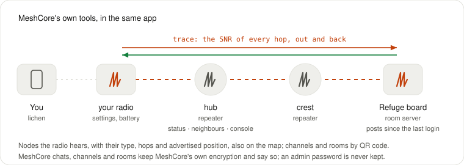
</picture>

lichen also does what the stock MeshCore apps do, so one app is enough on a mesh. People on those apps get a plain chat, and channels such as Public show next to your conversations; both, and room servers' posts, are marked as not lichen-encrypted. The Nodes tab lists the nodes your radio hears: those heard directly with their signal, rated against your own preset, the others with the repeaters they go through. A node's page shows the route that reaches you, each leg with its last signal, the signal over 7 days and, when you ask, the readings it sends: a repeater's or a room server's battery and temperature once you are logged in, as a guest at least; someone on the stock app answers only if they allow it. The map draws that route between the repeaters that advertise a position; a trace measures each hop of a path both ways; a repeater shows its status and neighbours and takes commands, its admin password typed each time and never kept. Settings › Radio settings sets the radio's LoRa preset, power, GPS, position and telemetry; the app remembers several radios, while your conversations stay with the phone. The official app's exported history can be imported once.

### 360 seconds an hour

<picture>
  <source media="(prefers-color-scheme: dark)" srcset="docs/readme/airtime-dark.svg">
  
</picture>

869.618 MHz sits in a sub-band where a transmitter may be on air 10 % of the time: 360 s per sliding hour. The phone counts its own transmissions; a medium that does not fit is refused with the time at which it would fit, and text and positions wait frame by frame.

## Build

| Crate | Role |
|---|---|
| `lc-meshcore` | `no_std` app side of the MeshCore companion protocol, USB framing, on-air header, ECDH, LoRa airtime, radio settings, traces and logins |
| `lc-proto` | `no_std` lichen frame, crypto, handshake, introduction, ACK-on-Error fragmentation |
| `lc-core` | sessions, contacts, paths, groups, location, search, MeshCore chats and tools, airtime budget, storage and backup; a fake MeshCore network for tests |
| `lc-media` | voice (Codec2) and image thumbnails (AVIF) for LoRa |
| `lc-bridge` | the Internet bridge: content over iroh or Tor, checked against its BLAKE3 hash |
| `lc-ffi` | UniFFI bindings for Swift and Kotlin, and the apps' demo network |
| `lc-cli` | `lichen` command line over USB: send, listen (with an echo bot), adverts, cards, a TCP bridge to a USB radio |

```sh
scripts/check.sh                                               # all checks (fmt, clippy, tests, no_std, cargo deny)
cargo run --release -p lc-cli -- sim --repeaters 3 --loss 10   # a transfer on the fake network
cargo run --release -p lc-cli -- info /dev/cu.usbmodem2141101  # a real companion over USB
```

### Tests

Every user-facing flow is a numbered scenario in [`docs/testing.md`](docs/testing.md): what it must do, and the tests that show it. Each scenario has a test, or a note saying why it has none. They run on the demo network, at the lowest layer that shows the flow:

- **Core:** `cargo test`, in `scripts/check.sh`, including the scenarios in `crates/lc-ffi/tests/`, which drive the API as the apps do.
- **Android:** Compose UI tests of the whole app on the JVM (Robolectric), no emulator: `scripts/build-android-core.sh`, then `cd apps/android && ./gradlew testDebugUnitTest`.
- **iOS:** XCUITests on a simulator: `scripts/ui-tests-ios.sh` (`--lang fr` for French, `--only <Class>` for one area).

CI runs all three on every pull request; the iOS tests only when it changes something the iOS app or its tests use, shared out over five macOS runners, with a French pass. A bug fixed comes with a test that failed before the fix.

### iOS app

```sh
scripts/build-ios-core.sh                 # Rust core → apps/ios/LichenCore.xcframework + Swift bindings
cp apps/ios/Local.example.xcconfig apps/ios/Local.xcconfig   # your Apple team id and bundle identifier
cd apps/ios && xcodegen generate          # Lichen.xcodeproj from project.yml
open Lichen.xcodeproj                     # Run on a simulator or an iPhone
```

Needs Xcode, [XcodeGen](https://github.com/yonaskolb/XcodeGen) and Rust (`rustup target add aarch64-apple-ios aarch64-apple-ios-sim`).

The simulator has no Bluetooth, but it reaches a real radio over TCP: `cargo run --release -p lc-cli -- bridge <serial port>` relays a USB radio on `127.0.0.1:5000`, and Settings › Pair a radio › Network connects to it (or the launch argument `-tcp 127.0.0.1:5000`). The same works on an iPhone with the Mac's address, or with a MeshCore companion on Wi-Fi. That link is neither encrypted nor authenticated: on a shared network someone can read and change the MeshCore chats, contacts and channels it carries (lichen's own messages stay end-to-end encrypted); the pairing screen says so.

#### On your own iPhone

A free Apple ID is enough. Once:

1. Xcode › Settings › Apple Accounts: sign in with your Apple ID; Xcode makes a "Personal Team".
2. `cp apps/ios/Local.example.xcconfig apps/ios/Local.xcconfig`, then set `DEVELOPMENT_TEAM` to that team's id and `LICHEN_BUNDLE_ID` to an identifier of your own (`org.yourname.lichen`: Apple gives each identifier to the first team that registers it).
3. Connect the iPhone by USB, unlock it and tap Trust. On the phone, Settings › Privacy & Security › Developer Mode, on, then restart.

Then, from a Terminal on the Mac (signing does not work over SSH):

```sh
scripts/install-ios.sh            # builds the core and the app (Release), installs it on the iPhone
```

The first launch may say "Untrusted Developer": Settings › General › VPN & Device Management › your Apple ID › Trust. A free team's profile lasts **7 days**: after that the app no longer opens until you run the script again; reinstalling keeps the messages and the identity. A free team can also register at most 10 app identifiers a week, 3 devices, and 3 apps per device.

What a free team allows, from [Apple's capability table](https://developer.apple.com/help/account/reference/supported-capabilities-ios) and [membership comparison](https://developer.apple.com/support/compare-memberships/) (checked 2026-11-16): background modes, keychain sharing and app groups yes; push notifications, iCloud, Sign in with Apple, associated domains, network extensions, NFC, Apple Pay and in-app purchase no. lichen asks for none of the latter: it has no entitlements file. What it uses needs only the default entitlements or an `Info.plist` line: Bluetooth in the background and location (`UIBackgroundModes`: `bluetooth-central`, `location`), the Keychain in the app's own default group, local notifications (no push), Face ID, the camera, the microphone, the local network (TCP to a radio), and file protection set per folder. For the same reason, sharing into lichen from other apps is "Open in lichen" (document types) rather than a share extension.

| Messages | Nodes | A node |
|---|---|---|
|  | 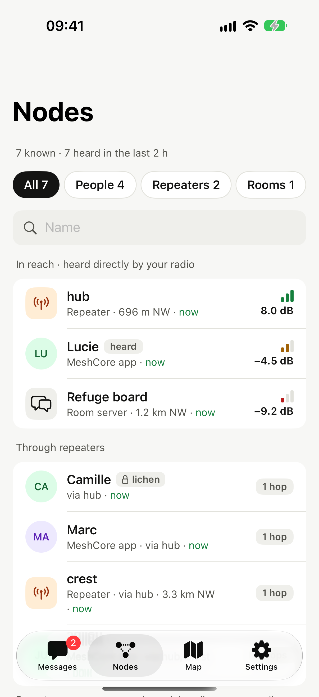 | 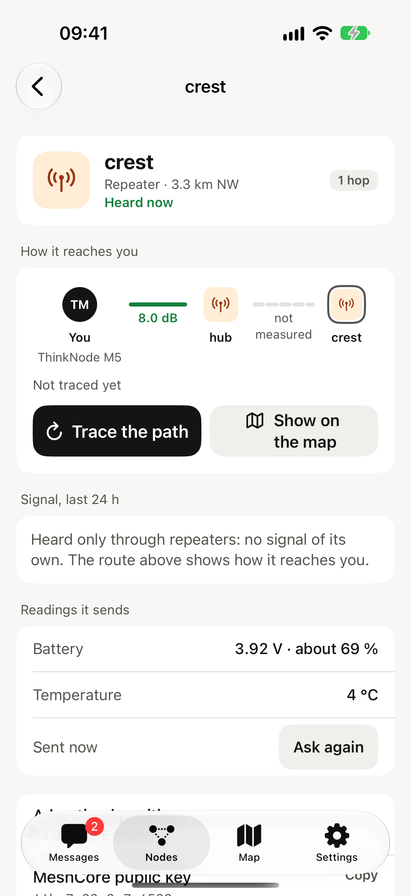 |
| **Chat** | **Map** | **Radio settings** |
| 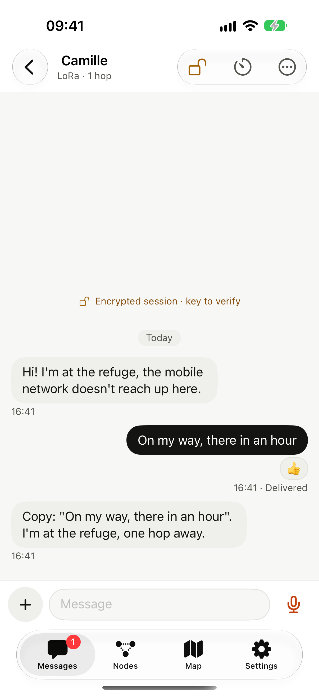 |  | 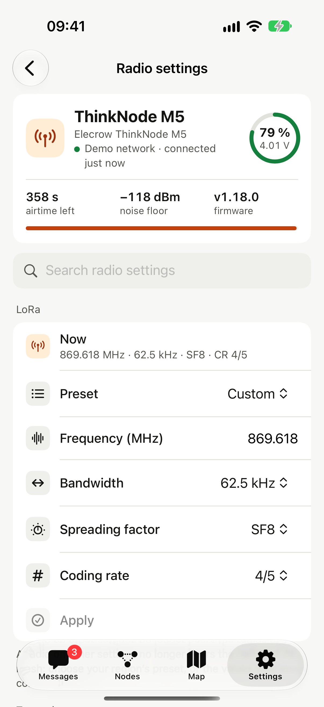 |

### Android app

```sh
scripts/build-android-core.sh                                  # Rust core (arm64, cargo-ndk) + Kotlin bindings
cd apps/android && ./gradlew assembleDebug                     # app/build/outputs/apk/debug/app-debug.apk
```

The core's database is SQLCipher on OpenSSL built from source, which needs perl and make (ADR-0036). The radio goes over Bluetooth (bonded first), over USB (OTG, a radio with the USB companion firmware) or over TCP (a Wi-Fi companion, or `lichen bridge` relaying a USB radio, which is how the emulator reaches a real one).

| Messages | Nodes | A node |
|---|---|---|
| 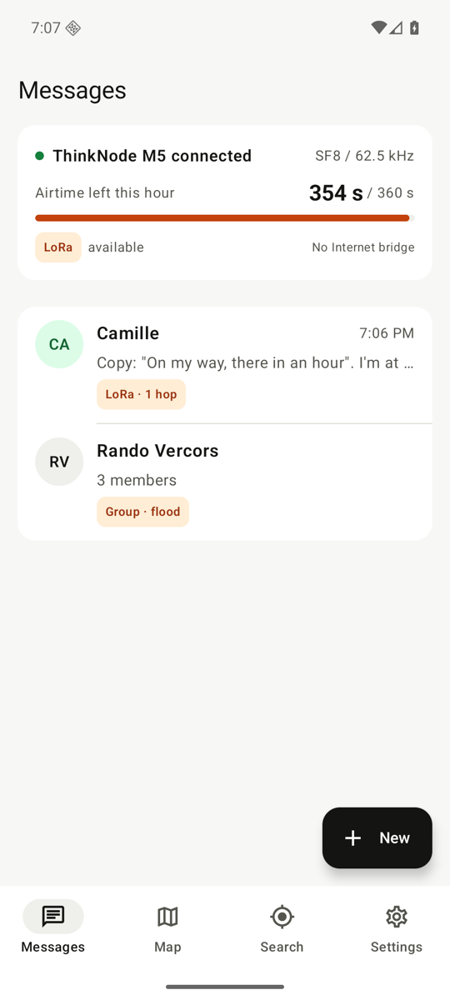 | 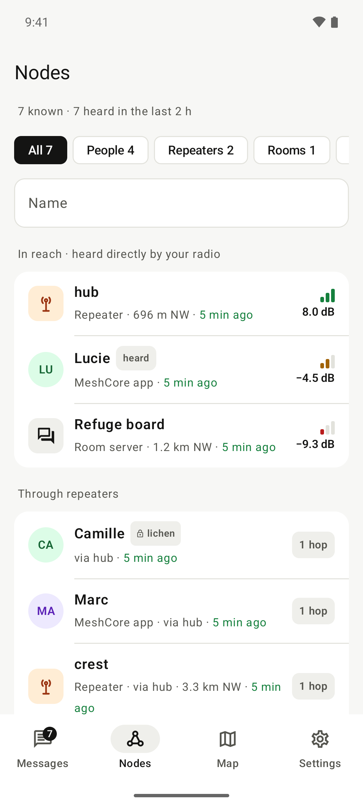 | 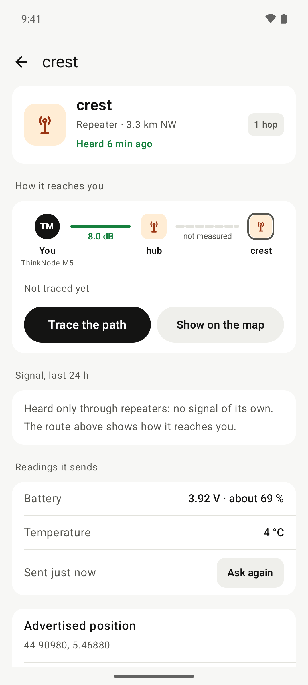 |
| **Chat** | **Map** | **Radio settings** |
| 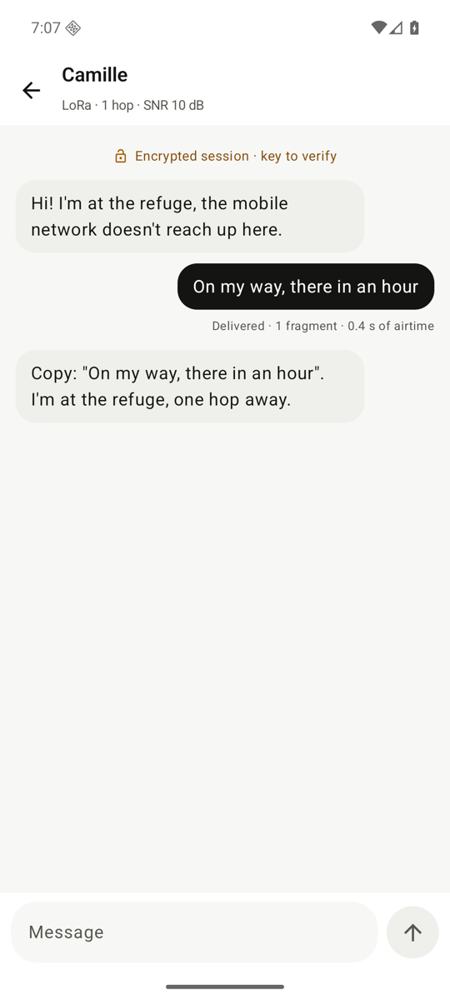 | 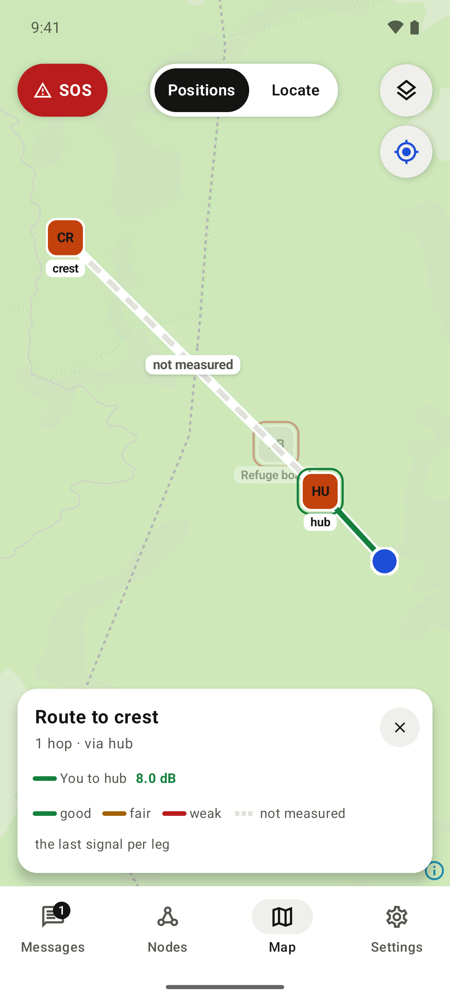 | 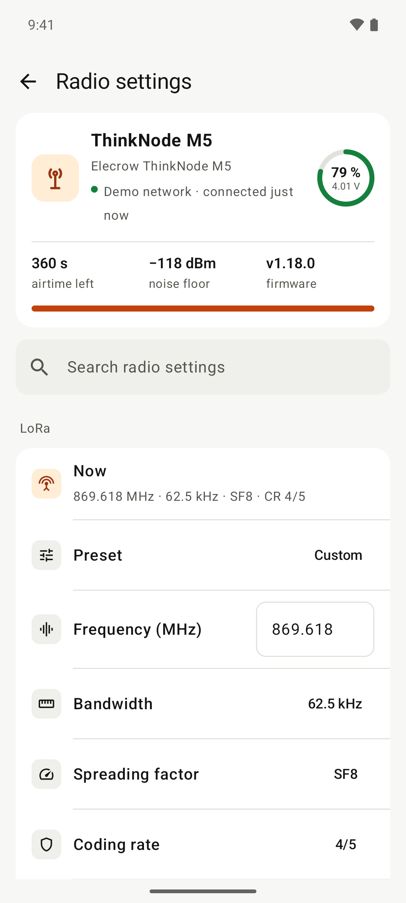 |

## Licence

lichen is free software, under the GNU General Public License, version 3 or later ([`LICENSE`](LICENSE)). Third-party code and content keep their own licences: [`THIRD-PARTY.md`](THIRD-PARTY.md).
