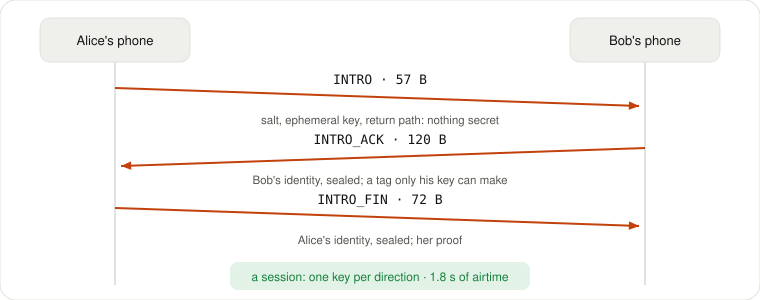
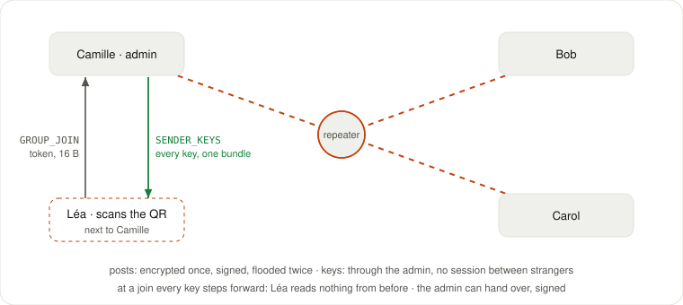
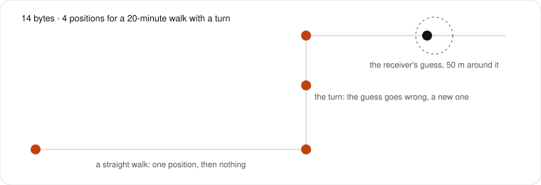
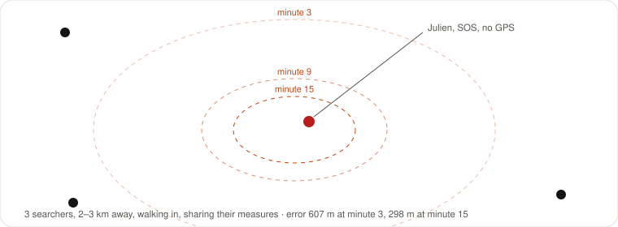
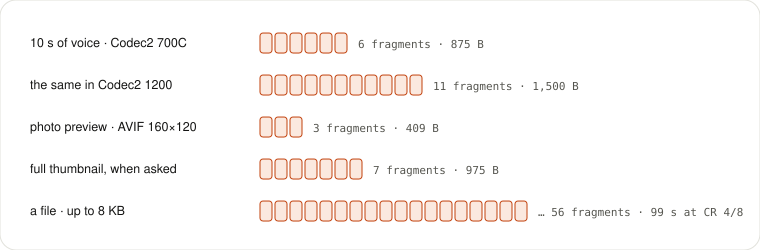
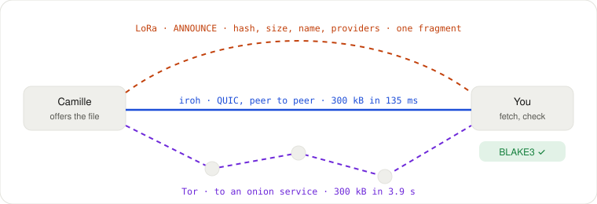
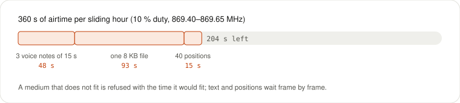
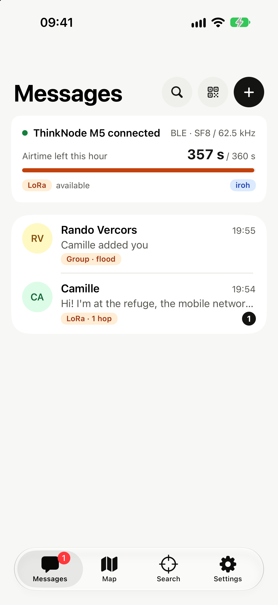
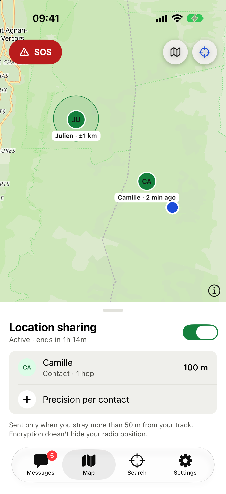

# lichen

Off-grid encrypted messaging.
<br clear="left">

Encrypted messaging on top of the **stock MeshCore** network: long fragmented messages, ChaCha20-Poly1305 with forward secrecy, private groups, media, location sharing and a search mode. No firmware is modified: the app talks to the MeshCore companion (Bluetooth or USB) and carries its frames in `RAW_CUSTOM` and `GRP_DATA` packets.

- Normative spec: [`docs/spec/protocol.md`](docs/spec/protocol.md); original design: [`docs/spec/design.md`](docs/spec/design.md) (French original: [`design.fr.md`](docs/spec/design.fr.md)).
- Decisions: [`docs/decisions/`](docs/decisions/). Mockups: [`docs/maquettes/`](docs/maquettes/). Logo and palette: [`docs/brand/`](docs/brand/).
- Shared Rust core; an iOS app (SwiftUI) and an Android app (Jetpack Compose).

| Crate | Role |
|---|---|
| `lc-meshcore` | `no_std` app side of the MeshCore companion protocol, USB framing, on-air header, ECDH, LoRa airtime |
| `lc-proto` | `no_std` lichen frame, crypto, handshake, ACK-on-Error fragmentation |
| `lc-core` | sessions, contacts, paths, airtime budget, storage; fake MeshCore network for tests |
| `lc-cli` | `lichen` command-line client over USB |
| `lc-ffi` | UniFFI bindings for Swift and Kotlin, and a demo network for the apps |
| `lc-media` | voice (Codec2) and image thumbnails (AVIF) for LoRa |
| `lc-bridge` | the Internet bridge: content over iroh or Tor, checked against its BLAKE3 hash |

## How lichen works

The same tour with live diagrams: [`docs/how-lichen-works.html`](docs/how-lichen-works.html), to open in a browser. Every figure comes from the spec, the decisions and the measurement log ([`docs/measurements.md`](docs/measurements.md)); fake-network figures are labelled as such.

[A message's journey](#a-messages-journey) · [A frame](#a-frame-byte-by-byte) · [Long messages](#long-messages-one-round-at-a-time) · [A messenger first](#a-messenger-first) · [Identity](#who-you-are-and-how-strangers-meet) · [Groups](#groups) · [Location](#location) · [Finding someone](#finding-someone) · [Media and files](#media-and-files) · [Internet bridge](#the-internet-bridge) · [Airtime](#360-seconds-an-hour)

### A message's journey

<picture>
  <source media="(prefers-color-scheme: dark)" srcset="docs/readme/journey-dark.svg">
  
</picture>

Everything lichen adds lives in a Rust core on the phone. The companion radio and the repeaters keep their stock MeshCore firmware: the core speaks the companion's documented protocol over Bluetooth or USB. Direct messages travel as `RAW_CUSTOM` packets along a known path, which repeaters forward without reading; groups travel as `GRP_DATA` floods. The core is IO-free (time and randomness are injected); the iOS and Android apps and the `lichen` command line only run it.

| 176 B | 184 B | 160 |
|---|---|---|
| largest companion frame | largest on-air payload (path up to 64 B) | hashes in each node's duplicate filter |

### A frame, byte by byte

<picture>
  <source media="(prefers-color-scheme: dark)" srcset="docs/readme/frame-dark.svg">
  
</picture>

Every frame starts with a 7-byte header in clear, authenticated with the body; five of its bytes become the nonce. The body is ChaCha20-Poly1305 as RFC 8439 defines it, with its full 16-byte tag (ADR-0028). `tag` counts datagrams per session and direction and `attempt` numbers the round, so a nonce never repeats under a key. Sessions are never stored: after a restart, a new handshake.

| 149 B | 64 | 9,536 B |
|---|---|---|
| data per fragment | fragments in a datagram | largest datagram |

### Long messages, one round at a time

<picture>
  <source media="(prefers-color-scheme: dark)" srcset="docs/readme/fragments-dark.svg">
  
</picture>

A datagram is cut into fragments sent in rounds (ACK-on-Error, after RFC 8724). The receiver answers a round with a 64-bit bitmap of what it holds, and the next round carries only what is missing. Hand-offs are paced for half-duplex repeaters, and the next frame waits for the answer it expects, so it does not collide with it at a shared repeater.

| 1000 / 1000 | 74.2 | 49 / 50 |
|---|---|---|
| 10 KB datagrams delivered at 10 % loss on the link | frames on average at 10 % loss (65 with none) | 10 KB over 3 repeaters at 10 % loss per link (fake network) |

### A messenger first

<picture>
  <source media="(prefers-color-scheme: dark)" srcset="docs/readme/messenger-dark.svg">
  
</picture>

Chatting off-grid comes first. A message is accepted while the radio is away, survives a restart, says why it waits, and can be cancelled until its first frame leaves; the phone keeps the intent (chat, text, expiry), never a session, key, nonce or ciphertext. Replies and reactions name their message by an 8-byte reference both phones compute. Stickers are animated emoji every phone already has, and a GIF travels as its GIPHY id only: one packet each, no API key. Group changes appear as lines in the conversation ("Léa joined", "Camille removed Bob").

| 24 h | 8 B | 2.1 s |
|---|---|---|
| a waiting message's life | reference a reply or reaction carries | a 👍 one hop away, every frame counted (fake network) |

### Who you are, and how strangers meet

<picture>
  <source media="(prefers-color-scheme: dark)" srcset="docs/readme/introduction-dark.svg">
  
</picture>

Your identity is a key made on your phone from a seed in the Keychain or Keystore, backed up as 24 words; the radio's key only routes. Strangers meet with a three-frame introduction on the Noise XX pattern; later sessions use HELLO / HELLO_ACK with fresh ephemeral keys. Comparing the 30-digit safety number, one tap from every conversation's header, or scanning a `lichen:1:` card in person marks a contact verified; a verified contact that suddenly shows another key is not adopted until you accept it.

| 1.8 s | 1.1 s | 6 × 5 | 24 |
|---|---|---|---|
| a first meeting, one hop | a later session | safety number digits | recovery words |

### Groups

<picture>
  <source media="(prefers-color-scheme: dark)" srcset="docs/readme/groups-dark.svg">
  
</picture>

A post is encrypted once with the sender's key, signed with the sender's identity, and flooded twice. Keys travel over pairwise sessions; when people join, the admin relays every key, so strangers never need a session with each other. People next to you join by scanning a QR code that holds the admin's public card and a 10-minute token, never a key. When someone leaves or is removed, everyone draws a new key. Members keep the last hour of posts: one who misses a post asks the author or the admin for it, and gets the original signed envelope back, shown as "arrived late".

| 100 % | 130 s | 237 s | 1–32 |
|---|---|---|---|
| posts delivered at 10 % loss per link with recovery (96.0 % without) | two people join by QR: every key everywhere (median of 10; 489 s before the relay) | a group of 5 from contacts (median of 10; 412 s before) | members; a group may start with the admin alone |

### Location

<picture>
  <source media="(prefers-color-scheme: dark)" srcset="docs/readme/location-dark.svg">
  
</picture>

A position is 14 bytes. Both sides extrapolate the last one along its heading and speed; a new one goes out only when reality drifts more than 50 m from the guess. A coarse position is the centre of a fixed grid cell, never random noise; standing still, only a heartbeat goes out.

| 4 | 33 B | ≈ 1.19 m |
|---|---|---|
| positions for a 20-minute walk with a turn | one direct position on air (365 ms) | latitude step |

### Finding someone

<picture>
  <source media="(prefers-color-scheme: dark)" srcset="docs/readme/search-dark.svg">
  
</picture>

An SOS without GPS still sends a short beacon every 2 minutes. Searchers measure each one, ping when allowed and share what they measure; a particle filter keeps a heat map and a 95 % ellipse. Secondary to messaging: it runs for an SOS, or with the group's consent.

| 2.5 → 0.75 km | 300 m | 1.3 s |
|---|---|---|
| 95 % semi-axis, minute 3 → 15 (median of 10, fake network) | error at minute 15 | airtime a minute per searcher (6 s allowed) |

### Media and files

<picture>
  <source media="(prefers-color-scheme: dark)" srcset="docs/readme/media-dark.svg">
  
</picture>

Voice is Codec2 (700C by default), listened to before sending. Photos are AVIF thumbnails: a preview of at most 426 bytes, the full thumbnail when asked. Files of any type go too: up to 8 KB in one LoRa datagram, compressed when that helps, anything larger over the Internet bridge. Media go to contacts only, never flooded, and their airtime is shown before sending.

| 875 B | 409 / 975 B | 2.3 KB |
|---|---|---|
| 10 s of voice, 6 fragments | photo preview / full thumbnail | a 25 KB hiking track (GPX) on the air, compressed: 29 s at CR 4/8 |

### The Internet bridge

<picture>
  <source media="(prefers-color-scheme: dark)" srcset="docs/readme/bridge-dark.svg">
  
</picture>

For a full-resolution photo or any file up to 64 MiB, one LoRa datagram announces its BLAKE3 hash, size, name and providers; the phone fetches it over iroh (QUIC, peer to peer or through relays) or Tor (an onion service derived from your seed) and drops it unless the hash matches.

| 135 ms | 343 ms | 3.9 s |
|---|---|---|
| 300 kB over iroh | the same through relays only | 300 kB over Tor |

### 360 seconds an hour

<picture>
  <source media="(prefers-color-scheme: dark)" srcset="docs/readme/airtime-dark.svg">
  
</picture>

869.618 MHz sits in a sub-band where a transmitter may be on air 10 % of the time: 360 s per sliding hour. The phone counts its own transmissions; a medium that does not fit is refused with the time at which it would fit, and text and positions wait frame by frame.

## iOS app

```sh
scripts/build-ios-core.sh                 # Rust core → apps/ios/LichenCore.xcframework + Swift bindings
cd apps/ios && xcodegen generate          # Lichen.xcodeproj from project.yml
open Lichen.xcodeproj                     # Run on a simulator or an iPhone
```

Without a MeshCore node (or in the simulator, which has no Bluetooth), Settings → **Try the demo network** runs the app's real core against a simulated network with two other users and a group, in real time.

| Messages | Chat | Map |
|---|---|---|
|  |  |  |

## Android app

```sh
scripts/build-android-core.sh                                  # Rust core (arm64, cargo-ndk) + Kotlin bindings
cd apps/android && ./gradlew assembleDebug                     # app/build/outputs/apk/debug/app-debug.apk
```

Android 12 or later. The radio over Bluetooth, over USB (OTG, a radio with the USB companion firmware) or over TCP (a Wi-Fi companion, or `lichen bridge` relaying a USB radio, which is how the emulator reaches a real one). The same demo network as on iOS in Settings.

| Messages | Chat | Map |
|---|---|---|
|  |  |  |

```sh
scripts/check.sh                                               # all checks
cargo run --release -p lc-cli -- sim --repeaters 3 --loss 10   # a transfer on the fake network
cargo run --release -p lc-cli -- info /dev/cu.usbmodem2141101  # a real companion over USB
```
